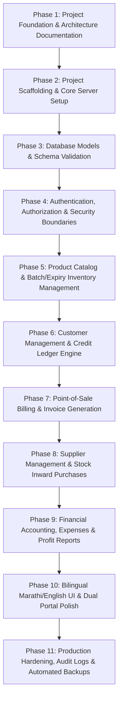

# Shivshree Agro Mart OS — Project Plan & Roadmap

## 1. Project Overview & Business Context

**Shivshree Agro Mart** is an active agricultural retail business located in Maharashtra, India, supplying farmers with:
- **Seeds** (hybrid, open-pollinated, certified varieties with germination/purity standards)
- **Fertilizers** (chemical, organic, bio-fertilizers, micro-nutrients, water-soluble grades)
- **Pesticides, Fungicides & Herbicides** (insecticides, weedicides, biopesticides, regulatory batch tracking)
- **Agricultural Equipment & Tools** (sprayers, drip fittings, tarpaulins, pruning shears, safety gear)
- **General Farm Supplies & Growth Promoters**

This system is **Shivshree Agro Mart OS** — a production-grade retail operating system custom-tailored for the day-to-day realities of Indian agricultural commerce: credit sales (*udhaari* / farmer *khaata*), seasonal batch tracking with expiry warnings, multiple payment modes (Cash, UPI, Credit, Split), Marathi-first bilingual operations, and strict separation between internal financial analytics and customer self-service.

---

## 2. Key Stakeholders & Security Boundaries

| Stakeholder | Role / Permissions | Accessible Surfaces |
| :--- | :--- | :--- |
| **Shop Owner** | Full super-admin authority; manages pricing, supplier invoices, profit/loss, staff accounts, tax reports, audit logs. | Internal Management Portal (All Modules + Financials) |
| **Shop Staff** (2–3 members) | Counter billing, inventory lookup, stock inward verification, customer khata collection recording. Restricted from supplier cost margins and net profit reports. | Internal Management Portal (POS, Inventory Read, Customer Collections) |
| **Farmer / Customer** | View own purchase bills, outstanding credit balance, payment receipts, and available retail product catalog. Strictly prevented from viewing other farmers' ledgers, supplier costs, or store financials. | Dedicated Farmer Portal (Self-Service) |

---

## 3. Technology Stack & Budget Constraints

- **Frontend**: React (v18+) + Vite for high-speed counter billing and light client footprint.
- **Styling**: Tailwind CSS (customized agricultural green palette `#15803d` / `#166534`, crisp neutral surfaces, high-contrast readable typography).
- **Backend**: Node.js + Express (RESTful API versioned under `/api/v1`).
- **Database**: MongoDB Atlas Free Tier (M0 tier: 512MB storage, capped connections, optimized indexing, zero hosting expense).
- **Bilingual Engine**: `i18next` + `react-i18next` supporting Marathi (मराठी) and Indian English.
- **Version Control**: Git & GitHub.
- **Tooling**: Antigravity IDE and VS Code with GitHub Copilot compatibility.
- **Development Budget**: **₹0 (Strict zero-cost requirement)**. No paid SaaS, paid APIs, or commercial infrastructure.

---

## 4. Phased Implementation Roadmap

### Phase 1: Project Foundation & Architecture (Current Phase)
- **Goals**: Verify dev environment, initialize version control, define project architecture, folder conventions, and roadmaps.
- **Deliverables**: `.gitignore`, `.env.example`, `PROJECT_PLAN.md`, `ARCHITECTURE.md`, `PROGRESS.md`.
- **Acceptance Criteria**:
  - Node.js, npm, and Git verified.
  - No existing business assets overwritten or deleted.
  - Zero secrets or credentials committed.
  - Documentation approved before code scaffolding.

### Phase 2: Project Scaffolding & Core Server Setup
- **Goals**: Create standard monorepo folder layout (`/client` and `/server`), configure root scripts, express server bootstrap with health checks, and Vite frontend.
- **Deliverables**: `server/package.json`, `client/package.json`, Express application entry point, Vite React setup with Tailwind CSS.
- **Acceptance Criteria**:
  - Running `npm run dev` boots both backend API (`/api/v1/health`) and client frontend.
  - Clean linting and zero build warnings.

### Phase 3: Database Connection & Schema Design
- **Goals**: Safe MongoDB Atlas connection management with auto-reconnect, graceful shutdown, and Mongoose schemas with validation.
- **Deliverables**: Mongoose connection utility, schemas for Users, Products, Batches, Customers, Invoices, Payments, Suppliers, Purchases, Expenses, and AuditLogs.
- **Acceptance Criteria**:
  - Accurate schema types: money stored in integer paise or high-precision Decimal128, quantities with unit enums (kg, liter, bag, piece).
  - Indexes configured for performance within free-tier RAM limits.

### Phase 4: Authentication, RBAC & Security Boundaries - [COMPLETED]
- **Goals**: Secure JWT authentication with HTTP-only cookies, password hashing via bcrypt (cost factor 12), role-based access control (`OWNER`, `MANAGER`, `CASHIER`, `CUSTOMER`).
- **Deliverables**:
  - Auth controller (`/api/v1/auth/login`, `/api/v1/auth/logout`, `/api/v1/auth/refresh`, `/api/v1/auth/me`).
  - Customer OTP request & verification flow (`/api/v1/auth/customer/login-request`, `/verify-otp`).
  - Refresh token rotation with SHA-256 token hashing and MongoDB TTL auto-cleanup.
  - Staff management controller (`/api/v1/staff`) restricted strictly to Owner, with immutable audit logging.
  - One-time owner provisioning CLI script (`server/src/scripts/provisionOwner.js`).
  - Authorization middlewares (`requireAuth`, `requireRole`, `requireSameShop`, `requireCustomerSelf`).
  - Rate limiting via `express-rate-limit` on authentication endpoints.
  - Frontend authentication context, in-memory access token storage, silent refresh, and role-protected routes (`/admin/dashboard`, `/customer/dashboard`).
- **Acceptance Criteria**:
  - Customers cannot access any internal management route.
  - Staff cannot query supplier purchase prices, profit margins, or promote themselves/others to OWNER.
  - Passwords hashed with cost factor 12; tokens never stored in localStorage.
  - 40/40 tests passing across 18 test suites.

### Phase 5: Product Catalog & Batch/Expiry Inventory Management
- **Status**: Completed & Verified
- **Goals**: Comprehensive agro product categorization (seeds, fertilizers, pesticides, tools), batch number tracking, manufacturing/expiry date tracking, stock alerts, immutable ledger movements.
- **Deliverables**:
  - Category Controller & Routes (`/api/v1/categories`) with bilingual names, unique slugs, and parent category support.
  - Product Controller & Routes (`/api/v1/products`) with SKU uniqueness, integer paise pricing, agricultural units, tax classifications (HSN & GST), and low-stock view.
  - Inventory Controller & Routes (`/api/v1/inventory/receipt`, `/adjustment`, `/stock`, `/batches`, `/movements`) backed by immutable `StockMovement` ledger and FEFO batch sorting.
  - Mongoose transaction helper (`withTransaction`) with seamless fallback for unsupported standalone MongoDB deployments.
  - Prevention of duplicate stock receipts by reference ID and negative stock checks with mandatory audit reasoning.
  - Responsive bilingual management frontend (`/admin/inventory`) with accessible tables, low-stock alerts, receipt/adjustment modals, and product details drawer.
  - 71 automated tests across 28 suites passing with 100% success.
- **Acceptance Criteria**:
  - Products linked to batches with individual expiry dates and purchase/selling prices.
  - Warning system flags batches expiring within 30, 60, or 90 days.
  - Expired and quarantined batches strictly blocked from sale.
  - Cashiers and Customers blocked from modifying stock, prices, or seeing supplier costs.

### Phase 6: Customer Management & Credit Ledger (Khaata / Udhaari) — [COMPLETED & VERIFIED]
- **Status**: Completed & Verified (Prompt 7 Milestone)
- **Goals**: Farmer registration with village/Taluka address, Aadhaar/mobile identity, customer-wise debit/credit ledger, repayment tracking, multi-invoice payment allocations, advances, aging buckets, and sandboxed passbook.
- **Deliverables**:
  - `CustomerLedgerEntry`: Immutable append-only schema capturing `OPENING_BALANCE`, `CREDIT_SALE`, `PAYMENT_RECEIVED`, `SALE_RETURN`, `CREDIT_NOTE`, `ADJUSTMENT`, and `REVERSAL`.
  - Double-Entry Convention: DEBIT (नावे) increases farmer debt; CREDIT (जमा) decreases debt; net balance = $\sum(\text{Debits}) - \sum(\text{Credits})$. Integer paise stored throughout.
  - Multi-Invoice Allocations (`PaymentAllocation`): Automatic FIFO or custom allocations across outstanding invoices with unallocated customer advances.
  - Billing Integration: POS credit sales automatically post DEBIT entries and counter-downpayment CREDITS; invoice cancellations atomically post REVERSAL CREDITS and return stock.
  - Customer Credit Profiles: Credit limit, available credit, overdue balance, last payment date, and aging buckets (0–30, 31–60, 61–90, 90+ days).
  - Staff Credit Workspace (`/admin/credit`): Bilingual farmer list, passbook, payment collections, manual adjustments, opening balance migrations, reversals, and print statements.
  - Farmer Self-Service Passbook (`/customer/dashboard`): Sandboxed access to live credit balance, passbook table, purchase bills, and printable statements.
  - Reconciliation Engine: Audits consistency across invoices, payments, allocations, reversals, and credit limits without destructive silent repairs.
  - 110 automated tests passing across 37 test suites.
- **Acceptance Criteria**:
  - Every credit sale increments customer balance; every payment receipt decrements it.
  - Direct balance editing strictly forbidden; corrections require authorized reversals with mandatory reasons.
  - Customer self-access strictly sandboxed to authenticated phone number and shop ID.
  - Multi-document ACID transactions with safe fallback.

### Phase 8: Supplier Management & Stock Inward Purchases — [COMPLETED & VERIFIED]
- **Status**: Completed & Verified (Prompt 8 Milestone)
- **Goals**: Supplier directory, purchase bill entry (DRAFT vs RECEIVED), automatic batch creation & stock increment, accounts payable ledger, multi-invoice payment allocations, advances, purchase returns with stock guards, and reversals.
- **Deliverables**:
  - `Supplier`: Schema extended with contact person, villageCity, district, state, pincode, supplierType, payment terms, credit limits, bank details, and GSTIN format validator.
  - `Purchase`: Model for inward purchase bills capturing supplier invoice #/date, line items with batch/lot numbers, manufacturing/expiry dates, purchase rates, discounts, intra/inter-state GST, freight charges, rounding, and status (`DRAFT`, `RECEIVED`, `CANCELLED`).
  - `SupplierLedgerEntry`: Immutable append-only Accounts Payable ledger capturing `OPENING_BALANCE`, `PURCHASE_INVOICE`, `PAYMENT_MADE`, `PURCHASE_RETURN`, `DEBIT_NOTE`, `CREDIT_NOTE`, `ADJUSTMENT`, and `REVERSAL`.
  - Double-Entry AP Convention: CREDIT (जमा) increases liability/payable; DEBIT (नावे) decreases payable; Net Payable = $\sum(\text{CREDITS}) - \sum(\text{DEBITS})$. All money stored in integer paise.
  - Multi-Document ACID Transactions: Receiving inward bills atomically creates/updates `Batch` records, creates `StockMovement` records (`INWARD`), posts `PURCHASE_INVOICE` credit to supplier ledger, and records downpayments.
  - Payment Allocations & Advances: Multi-purchase auto-FIFO and custom allocations across unpaid purchase bills, with unallocated amounts preserved as advance credit.
  - Controlled Cancellation & Purchase Returns: Cancellations reverse stock via `RETURN_OUTWARD` and neutralize payable via `REVERSAL`. Returns strictly validate batch stock availability before decrementing inventory.
  - Staff UI: Supplier directory & passbook drawer (`/admin/suppliers`), and Purchase Inward registry (`/admin/purchases`) with print-ready purchase vouchers.
  - 126 automated tests passing across 45 test suites.
- **Acceptance Criteria**:
  - Inward stock updates batch inventory and preserves FEFO expiry tracking.
  - Draft purchases do not alter stock or create payable liabilities until explicitly received.
  - Immutable ledger prevents direct balance manipulation; corrections handled via audited reversals.
  - Cashiers and Customers strictly blocked from viewing supplier purchase costs or managing suppliers.

### Phase 9: Financial Accounting, Expense Tracking & Profit/Loss Reports — [COMPLETED & VERIFIED]
- **Status**: Completed & Verified (Prompt 9 Milestone)
- **Goals**: Store daily operating expenses (rent, electricity, labor, transport), daily cash drawer reconciliation, expected vs counted cash, batch-based COGS, gross and operating profit calculation, receivables & payables summary, and inventory valuation.
- **Deliverables**:
  - `Expense`: Model for store operating expenditures with integer paise, categories (`RENT`, `ELECTRICITY`, `WATER`, `INTERNET_PHONE`, `SALARIES_WAGES`, `TRANSPORT_FUEL`, `MAINTENANCE`, `STATIONERY_PACKAGING`, `BANK_CHARGES`, `TEA_REFRESHMENT`, `MISCELLANEOUS`), payment modes (`CASH`, `UPI`, `BANK_TRANSFER`, `CHEQUE`), approval lifecycle (`DRAFT`, `PENDING_APPROVAL`, `APPROVED`, `REJECTED`, `REVERSED`), and append-only immutability hooks.
  - `CashDrawerSession`: Model for physical cash drawer sessions, tracking opening cash float, live expected cash, actual counted cash at closing, cash variance, closing user, and mandatory explanation note. Enforces at most one open session per shop.
  - Fund Segregation Engine (`cashbookUtils.js`): Authoritative aggregation of cash sales and credit collections versus cash expenses and supplier payments. Physical drawer cash is strictly segregated from digital UPI and bank transfer funds.
  - Profitability & COGS Engine (`profitabilityUtils.js`): Calculates Cost of Goods Sold directly from batch purchase costs linked to actual batches sold (never from current selling price or period purchase totals). Computes Gross Profit, Gross Margin %, Operating Expenses, and Operating Net Profit %. Includes disclosures that estimates are managerial and not statutory audits.
  - Financial Summary & Valuation: Outstanding customer receivables (Khata) and supplier payables (AP), plus physical stock inventory valuation derived from active batches.
  - Admin Workspaces:
    - `/admin/expenses`: Operating expense register, creation modal, approve/reject workflow, and audited reversals.
    - `/admin/cashbook`: Physical cash drawer monitoring, live expected cash, open/close drawer session modals, and historical session logs.
    - `/admin/daily-closing`: End-of-day cash reconciliation report, variance analysis, digital channels summary, and printable closing voucher.
    - `/admin/reports`: Multi-tab financial reporting dashboard (Profitability & COGS, Sales & Revenue, Expenses Breakdown, Receivables & Payables, Inventory Valuation, print, and CSV export).
  - 144 automated tests passing across 45 test suites.
- **Acceptance Criteria**:
  - Operating expenses require integer paise and cannot be silently edited/deleted once approved.
  - Physical drawer cash strictly excludes digital UPI / Bank transfer receipts.
  - COGS calculated from verified batch purchase costs of items actually sold.
  - Daily closing report compares expected cash with counted cash and detects discrepancies.
  - Reports and closing workflows restricted to Owner and Manager. Cashier access strictly limited to operational drawer session submission and expense draft.

### Phase 10: Bilingual Marathi/English UI & Dual Portal Polish — [COMPLETED & VERIFIED]
- **Status**: Completed & Verified (Prompt 10 Milestone)
- **Goals**: End-to-end integration audit across workflows A through G, security and authorization verification, dual-portal role boundaries, offline error resilience, bundle optimization, and launch readiness checklist.
- **Deliverables**:
  - Full end-to-end audit test suite (`e2e_integration_audit.test.js` - 22 integration tests) covering product receiving, counter POS sale, farmer credit lifecycle, supplier payment FIFO allocation, returns/cancellations, expenses and drawer closing, and financial reports.
  - Security hardening: customer token refresh customerId preservation, CORS idempotency preflight headers, cashier dashboard view restriction, supplier payment idempotency deduplication, and production JWT secret guards.
  - Bilingual coverage verified across Marathi (`mr.json`) and English (`en.json`) dictionaries with no missing translation keys.
  - Frontend bundle optimization: manual chunking for React, icons, and i18n reducing main bundle to 679 kB.
  - 166 automated backend tests passing across 54 test suites with zero failures.
- **Acceptance Criteria**:
  - All agricultural terminology accurately accessible in Marathi (खते, बियाणे, कीटकनाशके, शिल्लक रक्कम, पावती).
  - Customer portal clean, mobile-first, and strictly sandboxed to their own phone number/login.
  - Cashier view strictly hides store finances, reports, supplier details, and closing analytics.
  - Complete launch readiness audit and operational owner checklist documented.

### Phase 11: Production Hardening, Audit Logs & Automated Backups
- **Goals**: Detailed audit logging of sensitive actions (price changes, manual stock adjustments, credit waivers), automated backup scripts, rate limiting, and security checks.
- **Deliverables**: Audit log viewer for Owner, `mongodump` automation scripts, security headers (Helmet, rate limiting).
- **Acceptance Criteria**:
  - Immutable audit logs capture user ID, IP address, timestamp, previous value, and new value.
  - Full backup plan documented and tested.

---

## 5. Dependency & Risk Management

| Risk | Mitigation Strategy |
| :--- | :--- |
| **MongoDB Atlas 512MB Free Limit** | Optimize index count, prune or archive old audit logs, avoid storing image binaries in MongoDB (use local disk/free storage). |
| **Network Interruptions in Rural Retail** | Client-side optimistic UI state and pending-sync queue design for POS billing. |
| **Staff Misuse / Financial Leakage** | Backend-enforced role restrictions; staff cannot edit closed invoices or alter customer balances without Owner override. |
| **Zero-Budget Constraint** | Exclusively rely on open-source libraries, Node.js runtime, MongoDB Atlas free tier, and GitHub repository hosting. |
