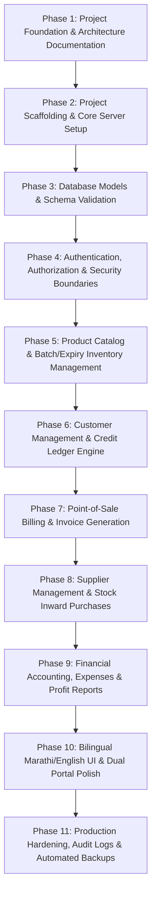

# Shivshree Agro Mart OS — Project Plan & Roadmap

## 1. Project Overview & Business Context

**Shivshree Agro Mart** is an active agricultural retail business located in Maharashtra, India, supplying farmers with:
- **Seeds** (hybrid, open-pollinated, certified varieties with germination/purity standards)
- **Fertilizers** (chemical, organic, bio-fertilizers, micro-nutrients, water-soluble grades)
- **Pesticides, Fungicides & Herbicides** (insecticides, weedicides, biopesticides, regulatory batch tracking)
- **Agricultural Equipment & Tools** (sprayers, drip fittings, tarpaulins, pruning shears, safety gear)
- **General Farm Supplies & Growth Promoters**

This system is **Shivshree Agro Mart OS** — a production-grade retail operating system custom-tailored for the day-to-day realities of Indian agricultural commerce: credit sales (*udhaari* / farmer *khaata*), seasonal batch tracking with expiry warnings, multiple payment modes (Cash, UPI, Credit, Split), Marathi-first bilingual operations, and strict separation between internal financial analytics and customer self-service.

---

## 2. Key Stakeholders & Security Boundaries

| Stakeholder | Role / Permissions | Accessible Surfaces |
| :--- | :--- | :--- |
| **Shop Owner** | Full super-admin authority; manages pricing, supplier invoices, profit/loss, staff accounts, tax reports, audit logs. | Internal Management Portal (All Modules + Financials) |
| **Shop Staff** (2–3 members) | Counter billing, inventory lookup, stock inward verification, customer khata collection recording. Restricted from supplier cost margins and net profit reports. | Internal Management Portal (POS, Inventory Read, Customer Collections) |
| **Farmer / Customer** | View own purchase bills, outstanding credit balance, payment receipts, and available retail product catalog. Strictly prevented from viewing other farmers' ledgers, supplier costs, or store financials. | Dedicated Farmer Portal (Self-Service) |

---

## 3. Technology Stack & Budget Constraints

- **Frontend**: React (v18+) + Vite for high-speed counter billing and light client footprint.
- **Styling**: Tailwind CSS (customized agricultural green palette `#15803d` / `#166534`, crisp neutral surfaces, high-contrast readable typography).
- **Backend**: Node.js + Express (RESTful API versioned under `/api/v1`).
- **Database**: MongoDB Atlas Free Tier (M0 tier: 512MB storage, capped connections, optimized indexing, zero hosting expense).
- **Bilingual Engine**: `i18next` + `react-i18next` supporting Marathi (मराठी) and Indian English.
- **Version Control**: Git & GitHub.
- **Tooling**: Antigravity IDE and VS Code with GitHub Copilot compatibility.
- **Development Budget**: **₹0 (Strict zero-cost requirement)**. No paid SaaS, paid APIs, or commercial infrastructure.

---

## 4. Phased Implementation Roadmap

### Phase 1: Project Foundation & Architecture (Current Phase)
- **Goals**: Verify dev environment, initialize version control, define project architecture, folder conventions, and roadmaps.
- **Deliverables**: `.gitignore`, `.env.example`, `PROJECT_PLAN.md`, `ARCHITECTURE.md`, `PROGRESS.md`.
- **Acceptance Criteria**:
  - Node.js, npm, and Git verified.
  - No existing business assets overwritten or deleted.
  - Zero secrets or credentials committed.
  - Documentation approved before code scaffolding.

### Phase 2: Project Scaffolding & Core Server Setup
- **Goals**: Create standard monorepo folder layout (`/client` and `/server`), configure root scripts, express server bootstrap with health checks, and Vite frontend.
- **Deliverables**: `server/package.json`, `client/package.json`, Express application entry point, Vite React setup with Tailwind CSS.
- **Acceptance Criteria**:
  - Running `npm run dev` boots both backend API (`/api/v1/health`) and client frontend.
  - Clean linting and zero build warnings.

### Phase 3: Database Connection & Schema Design
- **Goals**: Safe MongoDB Atlas connection management with auto-reconnect, graceful shutdown, and Mongoose schemas with validation.
- **Deliverables**: Mongoose connection utility, schemas for Users, Products, Batches, Customers, Invoices, Payments, Suppliers, Purchases, Expenses, and AuditLogs.
- **Acceptance Criteria**:
  - Accurate schema types: money stored in integer paise or high-precision Decimal128, quantities with unit enums (kg, liter, bag, piece).
  - Indexes configured for performance within free-tier RAM limits.

### Phase 4: Authentication, RBAC & Security Boundaries - [COMPLETED]
- **Goals**: Secure JWT authentication with HTTP-only cookies, password hashing via bcrypt (cost factor 12), role-based access control (`OWNER`, `MANAGER`, `CASHIER`, `CUSTOMER`).
- **Deliverables**:
  - Auth controller (`/api/v1/auth/login`, `/api/v1/auth/logout`, `/api/v1/auth/refresh`, `/api/v1/auth/me`).
  - Customer OTP request & verification flow (`/api/v1/auth/customer/login-request`, `/verify-otp`).
  - Refresh token rotation with SHA-256 token hashing and MongoDB TTL auto-cleanup.
  - Staff management controller (`/api/v1/staff`) restricted strictly to Owner, with immutable audit logging.
  - One-time owner provisioning CLI script (`server/src/scripts/provisionOwner.js`).
  - Authorization middlewares (`requireAuth`, `requireRole`, `requireSameShop`, `requireCustomerSelf`).
  - Rate limiting via `express-rate-limit` on authentication endpoints.
  - Frontend authentication context, in-memory access token storage, silent refresh, and role-protected routes (`/admin/dashboard`, `/customer/dashboard`).
- **Acceptance Criteria**:
  - Customers cannot access any internal management route.
  - Staff cannot query supplier purchase prices, profit margins, or promote themselves/others to OWNER.
  - Passwords hashed with cost factor 12; tokens never stored in localStorage.
  - 40/40 tests passing across 18 test suites.

### Phase 5: Product Catalog & Batch/Expiry Inventory Management
- **Goals**: Comprehensive agro product categorization (seeds, fertilizers, pesticides, tools), batch number tracking, manufacturing/expiry date tracking, stock alerts.
- **Deliverables**: Product CRUD APIs, Batch tracking with FIFO/FEFO (First-Expired-First-Out) logic, low-stock and near-expiry warning alerts.
- **Acceptance Criteria**:
  - Products linked to batches with individual expiry dates and purchase/selling prices.
  - Warning system flags batches expiring within 30, 60, or 90 days.

### Phase 6: Customer Management & Credit Ledger (Khaata / Udhaari)
- **Goals**: Farmer registration with village/Taluka address, Aadhaar/mobile identity, customer-wise debit/credit ledger, repayment tracking.
- **Deliverables**: Customer profiles, immutable transaction ledger, balance recalculation triggers, statement of accounts.
- **Acceptance Criteria**:
  - Every credit sale increments customer balance; every payment receipt decrements it.
  - Immutable ledger entries with audit trail prevent balance manipulation.

### Phase 7: Point-of-Sale (POS) Billing & Invoicing Engine
- **Goals**: Fast counter billing interface for keyboard-first operation, barcode/search support, Cash/UPI/Credit/Split payment handling, printable tax invoice.
- **Deliverables**: POS bill generation, stock deduction transaction, thermal & A4 invoice printing, WhatsApp bill sharing link.
- **Acceptance Criteria**:
  - Atomic transaction: Inventory deducted only upon successful invoice creation.
  - Credit portion automatically posted to customer ledger.
  - Supports Marathi invoice headers and item descriptions.

### Phase 8: Supplier Management & Stock Inward Purchases
- **Goals**: Supplier ledger, purchase order recording, inward batch intake, supplier payment tracking.
- **Deliverables**: Supplier directory, purchase bill entry, automatic stock increment, accounts payable ledger.
- **Acceptance Criteria**:
  - Inward stock updates batch inventory and recalculates weighted or batch-specific purchase costs.
  - Restricted strictly to Owner role.

### Phase 9: Financial Accounting, Expense Tracking & Profit/Loss Reports
- **Goals**: Store daily operating expenses (rent, electricity, labor, transport), daily sales summary, gross and net profit calculation.
- **Deliverables**: Expense tracker, daily cash drawer reconciliation, P&L dashboard with date-range filters.
- **Acceptance Criteria**:
  - Profit reports accurately factor in purchase cost of goods sold (COGS) and recorded operational expenses.
  - Visible only to Owner.

### Phase 10: Bilingual Marathi/English UI & Dual Portal Polish
- **Goals**: Seamless bilingual switching between Marathi and English across all forms, tables, and receipts. Refined dual-portal UX.
- **Deliverables**: Complete `mr.json` and `en.json` dictionaries, customer self-service dashboard, mobile-responsive layout.
- **Acceptance Criteria**:
  - All agricultural terminology accurately translated into Marathi (खते, बियाणे, कीटकनाशके, शिल्लक रक्कम, पावती).
  - Customer portal clean, mobile-first, and strictly sandboxed to their own phone number/login.

### Phase 11: Production Hardening, Audit Logs & Automated Backups
- **Goals**: Detailed audit logging of sensitive actions (price changes, manual stock adjustments, credit waivers), automated backup scripts, rate limiting, and security checks.
- **Deliverables**: Audit log viewer for Owner, `mongodump` automation scripts, security headers (Helmet, rate limiting).
- **Acceptance Criteria**:
  - Immutable audit logs capture user ID, IP address, timestamp, previous value, and new value.
  - Full backup plan documented and tested.

---

## 5. Dependency & Risk Management

| Risk | Mitigation Strategy |
| :--- | :--- |
| **MongoDB Atlas 512MB Free Limit** | Optimize index count, prune or archive old audit logs, avoid storing image binaries in MongoDB (use local disk/free storage). |
| **Network Interruptions in Rural Retail** | Client-side optimistic UI state and pending-sync queue design for POS billing. |
| **Staff Misuse / Financial Leakage** | Backend-enforced role restrictions; staff cannot edit closed invoices or alter customer balances without Owner override. |
| **Zero-Budget Constraint** | Exclusively rely on open-source libraries, Node.js runtime, MongoDB Atlas free tier, and GitHub repository hosting. |
